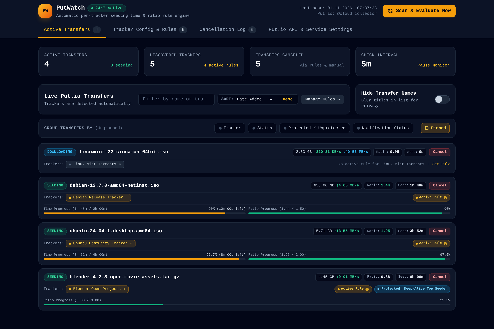
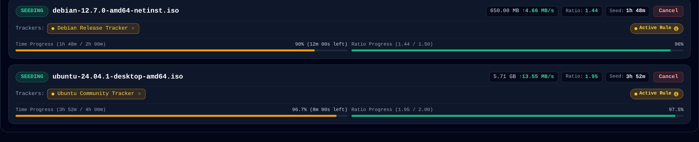
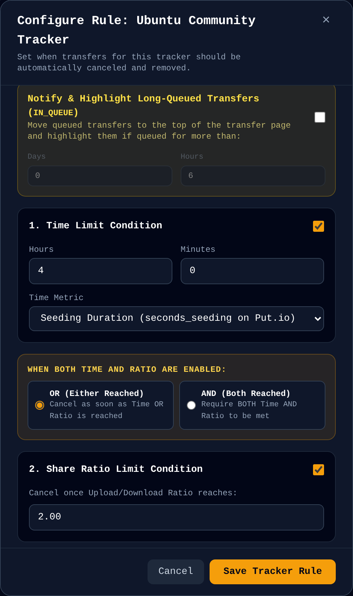
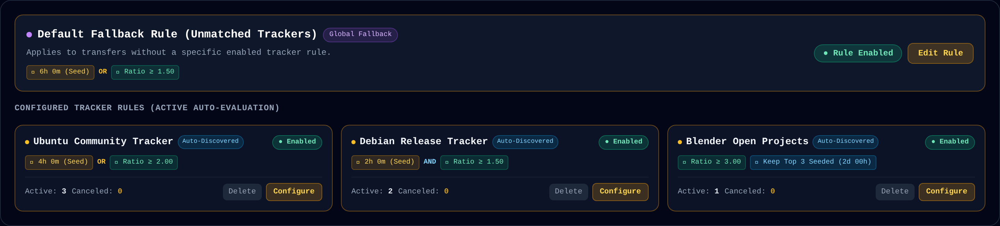
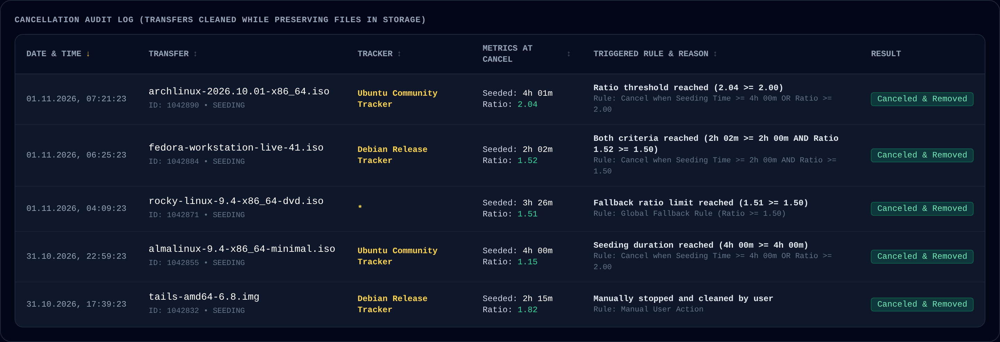
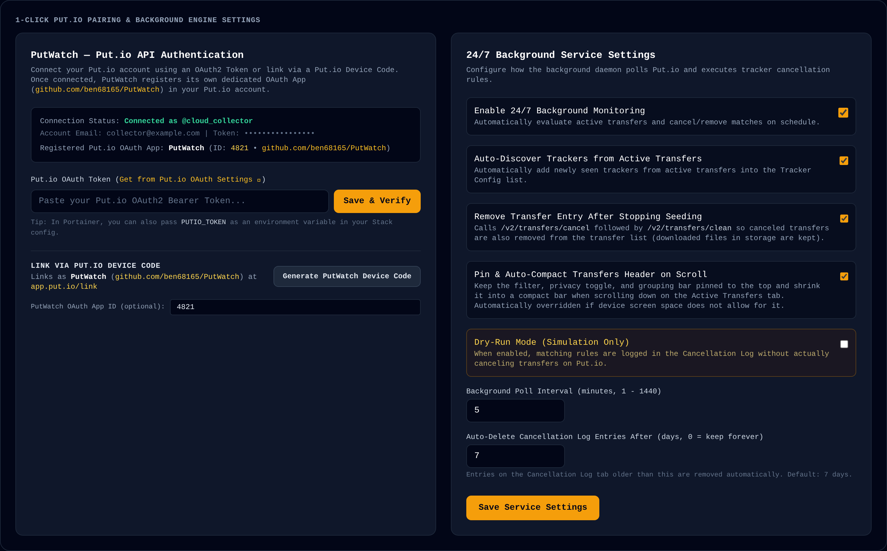

# PutWatch

<p align="center">
  
</p>

<h3 align="center">Set-and-forget seeding automation for Put.io</h3>

<p align="center">
  Keep your private tracker ratios healthy, reclaim transfer slots automatically, and put queue babysitting on cruise control.
</p>

<p align="center">
  <a href="https://github.com/ben68165/PutWatch/releases/tag/v1.0.2"></a>
  <a href="https://hub.docker.com/"></a>
  <a href="https://www.python.org/"></a>
  <a href="./LICENSE"></a>
</p>

---



---

## Why PutWatch?

[Put.io](https://put.io) is unmatched for fetching torrents directly to cloud storage at gigabit speeds. But when it comes to managing active transfers, you're on your own:

* **Private trackers demand discipline**: Strict rules require you to seed for 72 hours, reach a 1.5 ratio, or satisfy both conditions to maintain your account standing.
* **Public torrents clog your queue**: Left unattended, inactive or zero-peer transfers linger endlessly and tie up your maximum concurrent transfer slots.
* **Babysitting is tedious**: Manually monitoring progress, calculating ratios, and clicking "Cancel" dozens of times a week is pure friction.

**PutWatch is the missing automation brain for Put.io.** Running silently 24/7 in a lightweight Docker container, it sniffs tracker domains from incoming torrents, tracks seeding duration and share ratios in real time, and cleanly cancels transfers the exact moment your conditions are met.

Best of all: **Your downloaded files are 100% safe.** PutWatch only stops the torrent and cleans Put.io's active transfer queue; your media and downloads remain permanently stored in your Put.io cloud drive.

---

## Core Features & Visual Tour

### 1. Real-Time Dual Progress at a Glance
Stop guessing when a transfer is done seeding. PutWatch equips every active torrent with interactive dual progress bars measuring elapsed seeding time and live share ratio against your target goals.



- **Amber Progress Bar**: Live progress toward your target seeding time (or total transfer age), with dynamic time-remaining countdowns.
- **Emerald Progress Bar**: Live upload ratio progress toward your ratio target.
- **Live Metrics**: Real-time upload speeds, download throughput, connected swarm peers, and active rule badges.
- **Privacy Shield**: Instant toolbar switch to mask torrent titles when taking screenshots or sharing your dashboard.

---

### 2. Granular Per-Tracker Automation Engine
Different trackers require different strategies. PutWatch lets you create precision rules tailored to each community, choosing whether criteria trigger via `OR` or `AND` logic.



- **Flexible Condition Logic**:
  - `OR (Either Reached)`: Cancel as soon as either your seeding time **or** your share ratio goal is met.
  - `AND (Both Reached)`: Keep seeding until **both** time and ratio thresholds are satisfied.
- **Smart Metric Selection**: Evaluate by true active seeding duration (`seconds_seeding`) or total elapsed age since transfer creation.
- **Stalled Download Safeguards**: Automatically flag or purge downloads stuck in a downloading state without active seeds.
- **Keep-Alive Protection**: Pin your highest-seeded or largest torrents with dedicated immunity windows up to 48+ hours.

---

### 3. Zero-Setup Tracker Auto-Discovery & Global Fallback
No copying tracker URLs, typing hostnames, or digging through magnet links. PutWatch automatically intercepts announce hosts directly from active transfers and lists them ready for 1-click configuration.



- **Automatic Tracker Sniffing**: Inspects announce URLs (`announce.php`, `announce`, UDP ports) and extracts clean root domains.
- **Global Safety Net**: A customizable Fallback Rule automatically protects any torrent that doesn't yet have a dedicated tracker rule.
- **One-Click Duplication**: Easily copy proven rules across trackers or revert to global defaults in seconds.

---

### 4. Transparent Audit Trail (Retains up to 500 Events)
Every action taken by PutWatch is permanently recorded in a searchable, filterable cancellation history log.



- **Exact Decision Logs**: See precisely why a transfer was canceled (e.g. `Ratio threshold reached: 2.04 >= 2.00`).
- **Retained Metrics**: Audits final share ratio, total seeded duration, and timestamp.
- **Expanded Retention**: Stores up to 500 audit events with customizable auto-pruning.
- **Dry-Run Mode**: Test your rules safely in simulation mode before enabling live cancellations.

---

### 5. 10-Second Pairing & Set-and-Forget Operation
Connecting PutWatch to your Put.io account takes less than 10 seconds. No developer accounts or secret OAuth apps required.



- **Instant 1-Click Device Link**: Click **Generate PutWatch Device Code** and approve it instantly at [app.put.io/link](https://app.put.io/link).
- **Flexible Polling Interval**: Adjust scan frequency from every 1 minute to once an hour.
- **Auto-Cleanup**: Automatically cleans completed entries from Put.io's active list while leaving files untouched.

---

## Quick Start (Portainer / Docker)

### Option A: Portainer Stack (Recommended)
1. In **Portainer**, navigate to **Stacks** &rarr; **Add stack**.
2. Name the stack `putwatch` and paste the [`docker-compose.yml`](./docker-compose.yml):

```yaml
services:
  putio-tracker-monitor:
    build:
      context: .
      dockerfile: Dockerfile
    container_name: putio-tracker-monitor
    restart: unless-stopped
    ports:
      - "8080:8080"
    environment:
      - CONFIG_PATH=/data/config.json
      - PUTIO_TOKEN=${PUTIO_TOKEN:-}
      - POLL_INTERVAL=5
      - TZ=Europe/Berlin
    volumes:
      - putio_monitor_data:/data

volumes:
  putio_monitor_data:
```

3. Click **Deploy the stack**.
4. Open `http://<your-server-ip>:8080` in your browser.
5. In **Put.io API & Service Settings**, click **Generate PutWatch Device Code** to pair your account at [app.put.io/link](https://app.put.io/link).

---

### Option B: Docker CLI

```bash
docker run -d \
  --name putwatch \
  --restart unless-stopped \
  -p 8080:8080 \
  -v putwatch_data:/data \
  -e TZ=Europe/Berlin \
  -e POLL_INTERVAL=5 \
  ben68165/putwatch:latest
```

---

### Option C: Local Python (3.12+)

```bash
git clone https://github.com/ben68165/PutWatch.git
cd PutWatch

pip install -r requirements.txt
uvicorn app.main:app --host 0.0.0.0 --port 8080 --reload
```

---

## Configuration Reference

| Environment Variable | Default | Purpose |
|---|---|---|
| `CONFIG_PATH` | `/data/config.json` | Path where rules and audit logs are saved |
| `PORT` | `8080` | Web dashboard HTTP listening port |
| `POLL_INTERVAL` | `5` | Background evaluation frequency in minutes |
| `PUTIO_TOKEN` | *(empty)* | Optional pre-configured Put.io OAuth2 Bearer token |
| `PUTIO_APP_ID` | *(empty)* | Custom OAuth app ID (default uses PutWatch App ID) |
| `TZ` | `Europe/Berlin` | System timezone for audit log timestamps |

---

## Safety Guarantee

> [!NOTE]
> **PutWatch will never delete your media.**
> All operations use Put.io's `/transfers/cancel` (stop BitTorrent seeding) and `/transfers/clean` (clear transfer queue entry). Your downloaded video, music, software, and archive files in Put.io storage remain completely intact.

---

## License

Distributed under the [MIT License](./LICENSE). Open source and free forever.
