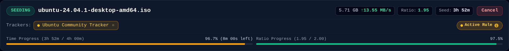
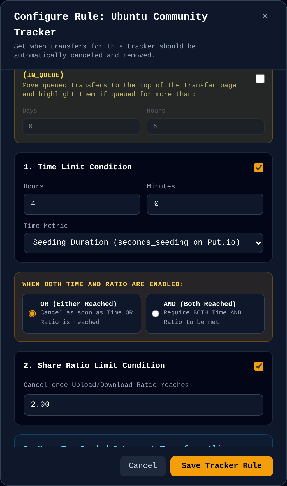
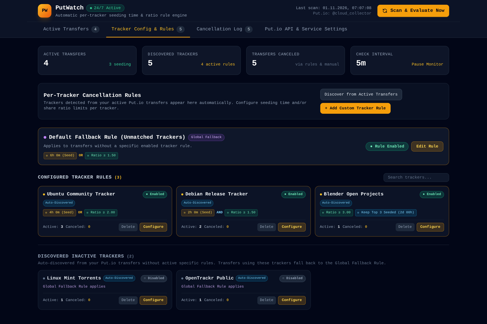
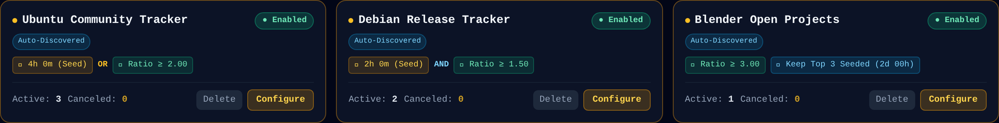
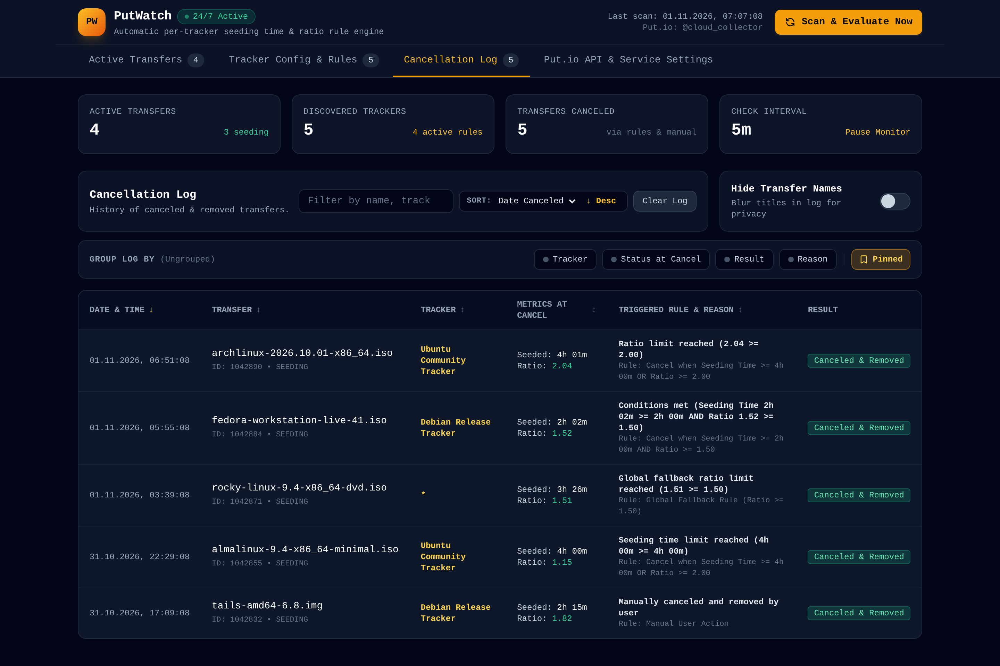
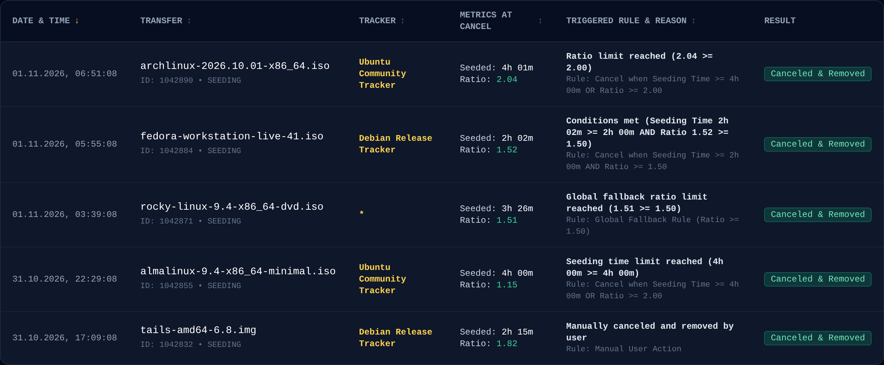
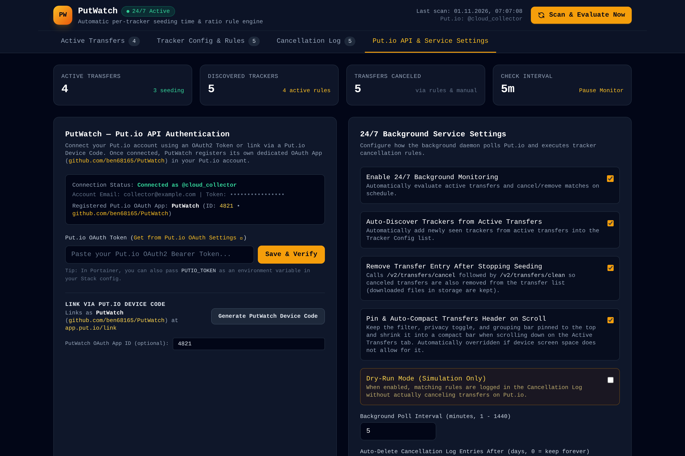

# PutWatch

[](https://github.com/ben68165/PutWatch/releases/tag/v1.0.1)
[](https://www.python.org/)
[](https://hub.docker.com/)
[](./LICENSE)

**PutWatch** is a 24/7 background service and modern web application that monitors active [Put.io](https://put.io) transfers (`GET /v2/transfers/list`), automatically identifies BitTorrent trackers from transfer metadata, and cancels & cleans finished transfers based on customizable per-tracker **seeding time**, **share ratio**, and **keep-alive** rules.


---

## Key Features

- **Automatic Tracker Identification**: Inspects active Put.io transfers via the `tracker` field, `trackers` array, and magnet link `tr=` announce parameters to automatically discover trackers.
- **Per-Tracker Rule Engine**:
  - **Time Limit**: Enforce maximum seeding time (`seconds_seeding`) or total transfer age in hours/minutes.
  - **Ratio Limit**: Set target share ratio thresholds (`current_ratio`).
  - **Boolean Operators**: Combine criteria using **OR** (*cancel when either time OR ratio is reached*) or **AND** (*cancel only when both time AND ratio are met*).
  - **Global Fallback Rule**: Catch transfers from any unconfigured or new trackers.
  - **Keep-Alive Protection**: Protect top-seeded or largest transfers from cancellation for dedicated seeding periods.
- **Safe Cancellation & Cleanup**:
  - Stops seeding via `POST /v2/transfers/cancel` and cleans entries from Put.io's transfer list via `POST /v2/transfers/clean`.
  - **Your downloaded files in Put.io storage remain untouched.**
- **24/7 Responsive Web GUI & Audit Log**:
  - Live progress bars showing real-time progress toward time and ratio limits.
  - Filter by name or tracker, group by tracker or status, sort, and toggle privacy masking.
  - Built-in Put.io OAuth token setup plus 1-click **Put.io Device Link Code** (`app.put.io/link`).
  - Comprehensive audit log with up to 500 retained entries and **Dry-Run (simulation)** mode.

---

## Visual Feature Tour

### 1. Active Transfers & Real-Time Dual Progress Bars
Each active transfer card clearly displays live metrics (transfer speed, peers, seeds, file size, seeding time, and ratio) along with interactive dual progress bars toward the configured time and ratio limits.



- **Yellow Progress Bar**: Visualizes elapsed seeding time (or transfer age) relative to target time.
- **Green Progress Bar**: Visualizes current upload ratio relative to target ratio.
- **Active Rule Chip**: Shows which rule is governing the transfer, with a hover tooltip explaining the exact evaluation criteria.
- **Privacy Masking**: One-click toggle in the toolbar to blur transfer names when sharing screenshots.

---

### 2. Flexible Per-Tracker Rule Engine (Time & Ratio Conditions)
Open the rule modal for any tracker to define custom cancellation thresholds and specify whether conditions operate via `OR` or `AND` logic.



- **Condition Logic**:
  - **OR (Either Reached)**: Stops transfer as soon as either time OR ratio is satisfied.
  - **AND (Both Reached)**: Keeps transfer seeding until both time AND ratio goals are reached.
- **Metric Options**: Measure by actual Put.io seeding duration (`seconds_seeding`) or total elapsed age since transfer creation.
- **Immediate Finished Handling**: Option to immediately cancel and clean transfers marked as `COMPLETED` by Put.io without waiting.
- **Stalled Download Detection**: Highlight or cancel stuck downloading transfers after a configurable delay.
- **Keep-Alive Protection**: Exempt top seeders or largest torrents from cancellation for a specified duration.

---

### 3. Tracker Config & Discovered Trackers Dashboard
View all configured tracker rules alongside newly auto-detected trackers from your active transfer queue.





- **Global Fallback Rule**: Default safety net for any tracker without an explicit rule.
- **Quick Rule Copying**: Copy configuration between trackers or revert to fallback defaults with one click.
- **Discovered Trackers**: Newly detected trackers appear automatically in the inactive list, ready to be configured.

---

### 4. Cancellation Audit Log (Retains up to 500 Entries)
Full audit trail of every canceled and cleaned transfer, including the exact trigger reason, ratio at cancellation, total seeded duration, and timestamp.





- Filter by transfer title, tracker, or cancellation reason.
- Group entries by Tracker, Status at cancel, or Result.
- Configurable log retention (default 7 days, up to 500 entries).

---

### 5. Settings, Authentication & Dry-Run Mode
Configure background polling intervals, connect your Put.io account via API token or Device Link Code, and test your configuration in simulation mode before taking real actions.



---

## Deploying in Portainer (Recommended for 24/7 Server)

### Portainer Stack
1. In **Portainer**, navigate to **Stacks** &rarr; **Add stack**.
2. Paste the contents of [`docker-compose.yml`](./docker-compose.yml):
   ```yaml
   services:
     putio-tracker-monitor:
       build:
         context: .
         dockerfile: Dockerfile
       container_name: putio-tracker-monitor
       restart: unless-stopped
       ports:
         - "8080:8080"
       environment:
         - CONFIG_PATH=/data/config.json
         - PUTIO_TOKEN=${PUTIO_TOKEN:-}
         - PUTIO_APP_ID=${PUTIO_APP_ID:-}
         - POLL_INTERVAL=${POLL_INTERVAL:-5}
         - TZ=${TZ:-Europe/Berlin}
       volumes:
         - putio_monitor_data:/data

   volumes:
     putio_monitor_data:
   ```
3. Deploy the stack.
4. Open `http://<your-server-ip>:8080` in your web browser.
5. In **Put.io API & Service Settings**, paste your Put.io OAuth token or click **Generate PutWatch Device Code** to link your account at [app.put.io/link](https://app.put.io/link).

---

## Environment Variables

| Variable | Default | Description |
|---|---|---|
| `CONFIG_PATH` | `/data/config.json` | Path to persistent configuration and rule file |
| `PORT` | `8080` | Web server listening port |
| `PUTIO_TOKEN` | *(empty)* | Optional initial Put.io OAuth2 Bearer token |
| `PUTIO_APP_ID` | *(empty)* | Optional Put.io OAuth App ID for device link authentication |
| `POLL_INTERVAL` | `5` | Background evaluation interval in minutes |
| `TZ` | `Europe/Berlin` | Timezone for logs and UI timestamps |

---

## Running Locally (Python 3.12+)

```bash
# Clone the repository
git clone https://github.com/ben68165/PutWatch.git
cd PutWatch

# Install dependencies
pip install -r requirements.txt

# Run the application
uvicorn app.main:app --host 0.0.0.0 --port 8080 --reload
```

Open `http://localhost:8080` in your browser.

---

## License

This project is licensed under the [MIT License](./LICENSE).
